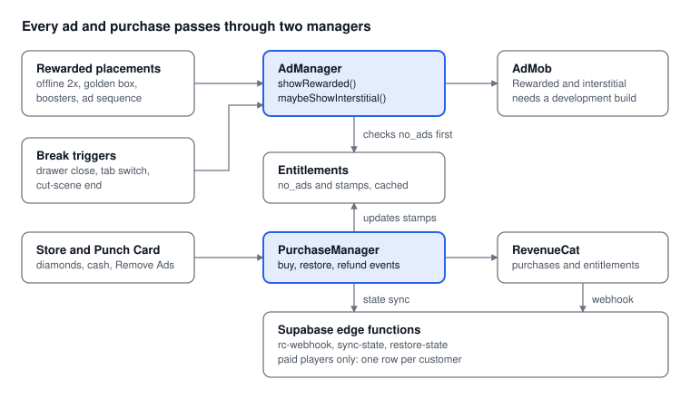

# Slice Empire: Monetization Design Doc

Oct 29, 2026 · @Julien

Source: Claude Docs "Slice Empire: Monetization Design Doc" (https://claude.ai/artifact/RR9WDd96PRJSHkyMTxxvNQ)

## Overview and locked decisions

Slice Empire earns from rewarded ads first, in-app purchases second, and interstitials last, and it launches on iOS before Android. Everything below is built so a paying player never feels punished and a free player never feels blocked.

| Decision | Locked answer |
| --- | --- |
| Platform | iOS first (Expo / React Native); Android follows on the same code |
| Diamonds | Vanity items, plus booster purchases (ad or 10-20 diamonds per booster) |
| Remove Ads | $3.99 one-time. Forced ads vanish; every rewarded ad is granted instantly with no video |
| Free No Ads | Spend $20 on diamond packs (20 stamps on the Pizza Punch Card) |
| 10-stamp reward | Special manager with a permanent +25% income on all pizzerias |
| Identity | Anonymous. Restore Purchases covers reinstalls and new devices |
| Server data | Only paying players get a database record: game state and purchases in one row |
| Free players | Game state stays on the device only |

## Store

The store sells cash that scales with the player's income, diamonds for vanity and boosters, and two one-time offers. Cash is priced in hours of current income, because a fixed amount like $1M is worthless by the second neighborhood.

**Cash packs** (amount recalculated from the player's income per second at the moment of purchase):

| Pack | Price | Grants |
| --- | --- | --- |
| Small | $0.99 | 2 hours of income |
| Medium | $4.99 | 12 hours of income |
| Large | $9.99 | 30 hours of income |

**Diamond packs** (all earn Punch Card stamps, see the Punch Card section):

| Pack | Price | Diamonds | Stamps |
| --- | --- | --- | --- |
| Pinch | $0.99 | 80 | 1 |
| Slice | $1.99 | 170 | 2 |
| Pie | $4.99 | 500 | 5 |
| Party | $9.99 | 1,200 | 10 |
| Catering | $19.99 | 2,600 | 20 |

**One-time offers:**
- **Remove Ads, $3.99.** Details in the Remove Ads section.
- **Starter Pack, $2.99.** Offered once, right after the player hires their first manager. Grants 150 diamonds and 4 hours of income.

**Vanity catalog,** all visible in the pizzeria cutaway: oven skins (brick, chrome, neon), worker uniforms, scooter skins, storefront signs, and seating decor. Items cost 50-400 diamonds. Players earn a small free diamond trickle from story cut-scene milestones and from opening each new pizzeria, so a free player can still afford one skin.

Store layout: the Punch Card sits at the top, the Remove Ads card below it, then diamonds, cash, and vanity tabs. Every price comes from the App Store product list through RevenueCat, never hardcoded, so regional pricing works without an update.

## Floating tap bonuses

A winged pizza box or delivery scooter crosses the cutaway every 60-120 seconds, and the player taps it once to collect cash. It only spawns while the game is open and in the foreground, so it rewards active play and cannot be collected offline.

| Rule | Value |
| --- | --- |
| Spawn interval | Random, 60-120 seconds, timer pauses when the app is backgrounded |
| Time on screen | 8 seconds, then it flies off |
| Reward | 30-60 seconds of current income |
| Golden version | About 1 in 10 spawns; offers 5x the reward for watching an ad |
| Interaction | A single tap only (no swipes or drags) |
| Hidden when | The upgrade drawer, a modal, or a cut-scene is open |
| No Ads buyers | Golden 5x is granted instantly with no video |

The spawn path is randomized on screen but the reward is computed from income when the tap lands, so the bonus stays meaningful as the player grows. A small whoosh sound and a subtle shimmer help players notice it without a notification.

## Boosters shop

Each booster costs one rewarded ad or a small number of diamonds, which gives diamonds a second use beyond vanity. Boosters are temporary; the only permanent booster in the game comes from the Punch Card manager.

| Booster | Effect | Duration | Diamond cost |
| --- | --- | --- | --- |
| Double Dough | 2x income | 10 min | 15 |
| Tap Frenzy | 3x tap income | 10 min | 10 |
| Hot Ovens | +50% cook speed | 15 min | 15 |
| Time Skip | Instantly grants 4 hours of income | Instant | 20 |

**Rules**
- Watching an ad on an active booster extends its timer, up to a 4-hour total cap.
- Ad purchases are limited to 3 per booster per day. Diamond purchases have no daily limit.
- Different boosters stack with each other. Two copies of the same booster do not stack; they extend the timer.
- Timers pause while the app is closed. A booster that is active when the player leaves keeps its remaining time, so players are never punished for leaving.
- A "Watch 5 ads, earn 30 diamonds" progress bar sits at the bottom of the shop. It shows how many ads are left and what the reward is.

**For No Ads buyers,** booster ads are granted instantly with no video, up to 3 per day per booster. After that, the booster costs diamonds.

## Rewarded ads

Rewarded ads are the main ad revenue source, and every one is opt-in. There are four placements, and all of them go through one `showRewarded(placement)` call so No Ads buyers can skip the video in a single place.

| Placement | Player sees | Reward |
| --- | --- | --- |
| Offline 2x | Modal on return: "You earned $X while away" with **Collect** and **2x (Ad)** | Doubles the offline earnings |
| Golden box | Rare floating box | 5x the normal bonus |
| Booster | Booster card in the shop | One booster, or +timer on an active one |
| Ad sequence | Progress bar: watch 5 ads | 30 diamonds |

**Offline earnings**
- Base offline cap is 2 hours. Manager and oven upgrades raise it to 12 hours.
- The modal appears only if the player was away more than 5 minutes.
- Both buttons are always shown. Collect is never hidden or de-emphasized beyond normal button styling.
- The offline total is calculated on the device from the last-seen timestamp, then the ad doubles that number. A clock check guards against players moving their phone clock forward.

**Ad handling**
- The next rewarded ad is preloaded as soon as the previous one closes.
- If no ad is loaded, the button shows "Ad not ready" and the player can still collect the normal amount. No spinner, no dead end.
- The reward is granted only when the SDK reports the reward callback, not when the ad merely starts.
- If the ad fails to show, nothing is consumed and no daily cap is used.

## Interstitials

A forced ad can appear at most once every 5 minutes, and only at a natural break. AdMob's guidance is to place interstitials at natural breaks and transitions, and Google Play restricts interstitials that appear in surprising places or are hard to dismiss. An idle game has few natural pauses, so a pure timer is not enough: a timer makes the player eligible, and a trigger decides when the ad shows.

**Eligible when all are true**
- 5 minutes have passed since the last ad of any kind, including rewarded ads.
- The player is not a No Ads owner.
- The session is older than 10 minutes, and this is not the player's first session.
- No booster is active, and no purchase has been made this session.

**Triggers (the next one to occur after eligibility)**
- The player closes the upgrade drawer.
- The player switches neighborhood tabs.
- A story cut-scene ends.

**Never shown**
- During an offline-earnings modal, a purchase flow, or a cut-scene.
- While a floating bonus is on screen.
- Immediately after the app opens.

**Implementation notes**
- Preload the next interstitial right after one closes. If none is ready when a trigger fires, skip that trigger rather than show a spinner.
- Set the AdMob frequency cap server-side as a backstop, higher than the in-game rule, so a client bug can't flood a player.
- Every third interstitial in a session is followed by a Remove Ads offer, at most once per day.
- Treat the 5-minute interval and the session-age exclusion as remote-config values so they can be tuned without an app update.

## Remove Ads

Remove Ads costs $3.99, is bought once, and means the player never watches an ad again: forced interstitials disappear, and every rewarded ad is granted instantly, with no video.

**What changes for an owner**

| Placement | Free player | Remove Ads owner |
| --- | --- | --- |
| Interstitial | Shown at natural breaks | Never shown |
| Offline 2x | Watch an ad | Tap the button, instant 2x |
| Golden box 5x | Watch an ad | Tap, instant 5x |
| Booster | Watch an ad | Instant, up to 3 per day per booster, then diamonds |
| Watch-5 sequence | Watch five ads | Tap five times, or a single claim |

**Offer placements**
1. A pinned card at the top of the store, below the Punch Card.
2. A pop-up after every third interstitial in a session, at most once per day.
3. A row in settings so players can find it on purpose.
4. Shortly after the player's first non-ad purchase.
5. Never in the first session, before the player has seen an ad.

The free path to the same upgrade is the Punch Card: a player who spends $20 on diamonds gets Remove Ads automatically.

**Edge cases**
- **Purchase during a pending ad:** cancel the ad if the purchase completes first.
- **Refund:** RevenueCat revokes the entitlement and ads return. If the player also holds 20+ stamps, the free entitlement from the Punch Card keeps them ad-free.
- **Player buys Remove Ads, then reaches 20 stamps:** the final reward becomes 500 diamonds plus the "Regular Customer" neon sign instead.
- **Offline mode:** the entitlement is cached on the device. The app checks it on launch and falls back to the cached value if the network is down.
- **Restore Purchases:** a button in settings restores both Remove Ads and the Punch Card for a reinstall or a new phone.

## Pizza Punch Card

Every diamond purchase stamps a loyalty card, and 20 stamps ($20 spent) unlocks Remove Ads for free. Stamps are tied to each pack's price tier, so players who buy small packs get the same deal as players who buy one big pack.

**Milestones**

| Stamps | Reward |
| --- | --- |
| 5 | A free vanity item: the red-checkered awning |
| 10 | **Special manager** with a permanent +25% income on all pizzerias |
| 20 | Remove Ads, plus the "Regular Customer" neon sign shown in the storefront |

The special manager is a named character with a distinct look and a short story cut-scene on arrival. The +25% income applies globally, multiplies with temporary boosters, and cannot be sold or replaced. Because it is the one permanent booster in the game, it is not purchasable any other way.

**How the player sees progress**
- A mini punch card sits at the top of the store with filled and empty stamp slots and the next reward highlighted.
- A small card icon with a count (for example 14/20) appears on the main HUD after the first stamp.
- The store shows the cheapest pack that completes the next milestone. Example: "3 stamps to go: grab Pie (500 diamonds) to finish your card." That pack gets a "Finishes your card!" ribbon.
- After a purchase, the card slides up and the player taps each new slot to stamp it, with a stamp sound. This uses taps only, consistent with the no-gestures rule.

**Rules**
- Only diamond packs earn stamps. Cash packs, the Starter Pack, and Remove Ads do not.
- A player who already bought Remove Ads still collects the 20-stamp reward as 500 diamonds plus the neon sign.
- A refund removes the stamps from that purchase. A reward already granted is revoked only if the total drops below that milestone.
- Stamps are tied to the price tier, not the local currency, so the card works the same in every country.
- Stamp totals live in the player's server record, which exists only for paying players (see Data model). A player's first purchase creates the record with 0 stamps and then adds the purchase's stamps.

## Data model and backend

A player gets a server record only after their first purchase, and that record is a single row holding both game state and purchase history. Free players never touch the database; their progress lives on the device.

```sql
create table players (
  original_app_user_id text primary key,   -- RevenueCat's ID for this customer
  game_state    jsonb not null default '{}',
  state_version int   not null default 1,
  purchases     jsonb not null default '[]', -- one entry per transaction
  stamps        int   not null default 0,    -- recomputed from purchases
  no_ads_source text,                        -- 'purchase' | 'punch_card' | null
  created_at    timestamptz not null default now(),
  updated_at    timestamptz not null default now()
);
alter table players enable row level security;  -- no client policies
```

Each `purchases` entry holds `transaction_id`, `product_id`, `stamps`, `purchased_at`, and `refunded_at`. Stamps are the sum of stamps from entries with no refund date. The `transaction_id` makes every webhook write idempotent.

**Who is trusted for what**

| Data | Source of truth | Why |
| --- | --- | --- |
| Purchases, stamps, entitlements | RevenueCat webhook | The client can't forge a receipt |
| Game state | The device, copied to the server | Single-player game; cheating costs nobody else anything |

**Flows**
1. **First purchase.** RevenueCat confirms the purchase and fires the webhook. The `rc-webhook` edge function creates the row if it does not exist, adds the purchase, and recomputes stamps. The client then uploads its full local state through `sync-state`.
2. **Later purchases.** The webhook appends the purchase and recomputes stamps. At 20 stamps it grants a lifetime `no_ads` entitlement through RevenueCat's promotional entitlement API and sets `no_ads_source = 'punch_card'`.
3. **Ongoing sync (paid players only).** The client pushes state after every purchase and diamond spend, every 2 minutes while the game is open, and when the app is backgrounded. Writes carry `state_version`; the server rejects a write whose version is older than the stored one.
4. **Reinstall or new phone.** The player taps Restore Purchases. RevenueCat returns the customer's `original_app_user_id`, and `restore-state` looks up the row and sends it back. A player who has already started a fresh local game chooses between the cloud save and this device.
5. **Refund.** RevenueCat sends a refund event, the webhook stamps `refunded_at`, and stamps and entitlements are recomputed.

**Security**
- All table access goes through edge functions using the service role. The app never talks to the table directly.
- The webhook checks RevenueCat's shared authorization header and ignores anything without it.
- RevenueCat anonymous IDs are random, so the ID works as the player's credential. It is stored in the iOS Keychain, and `sync-state` and `restore-state` verify it against RevenueCat's customer record before reading or writing.
- An account system is not needed now. If Sign in with Apple is added later, the row can gain a second key without a migration of game state.

## Client architecture

No screen calls AdMob or RevenueCat directly. Every ad goes through `AdManager`, every purchase through `PurchaseManager`, and both read one `Entitlements` cache. That is what lets Remove Ads work in a single place.



Text version of the diagram:

- Screens (rewarded placements, break triggers, store and Punch Card) call `AdManager` or `PurchaseManager`.
- `AdManager` reads `Entitlements` and talks to AdMob.
- `PurchaseManager` writes to `Entitlements`, talks to RevenueCat, and syncs state to Supabase.
- RevenueCat sends webhooks to the Supabase `rc-webhook` function.

- **`showRewarded(placement)`:** if `no_ads` is active, it grants the reward immediately and shows nothing. Otherwise it shows the ad and grants the reward only on the SDK's reward callback.
- **`maybeShowInterstitial(trigger)`:** applies the eligibility rules from the Interstitials section and returns silently for `no_ads` owners.
- **`Entitlements`:** holds `no_ads` and the stamp count, saved on the device and refreshed on launch, on returning to the foreground, and after every purchase.
- **`PurchaseManager`:** wraps buying, Restore Purchases, and refund events, and triggers state sync for paid players.
- **Tunable values** (interstitial interval, booster durations, daily caps, spawn timers) load from a remote config file with defaults baked into the app, so balance changes ship without an App Store release.
- **Expo setup:** a development build is required, since Expo Go cannot run the AdMob or RevenueCat native modules. Local save data uses on-device storage with an autosave every 30 seconds and on backgrounding.

## Compliance and store requirements

The design is built to pass App Store review and AdMob policy on the first try. Re-check each item against the current Apple and Google rules at submission time, since both change.

| Requirement | How the design meets it |
| --- | --- |
| Apple in-app purchase | Diamonds, cash, Starter Pack, and Remove Ads all use StoreKit through RevenueCat |
| Restore Purchases | A button in settings; Remove Ads is a non-consumable, so Apple expects it |
| App Tracking Transparency | The prompt shows before the first ad request; declining still serves non-personalized ads |
| Consent in the EU and UK | Google's consent form (UMP) runs before any ad request in those regions |
| Privacy labels and policy | Declare AdMob, RevenueCat, and the Supabase record (purchase history and game state tied to an anonymous ID); link a privacy policy |
| Rewarded ads | Always opt-in, never forced, reward granted only on the SDK callback |
| Interstitials | Natural breaks only, never on app open, never back-to-back with another ad |
| Accidental taps | Ads never sit under a floating bonus or a primary button |
| Randomized rewards | The golden box is free, and no purchase has a random outcome, so no odds disclosure is needed |
| Data requests | A contact path to request deletion of a paid player's server record |

**Audience.** The game is not aimed at children. Set the age rating and AdMob's child-directed setting to match before submission, because kids categories restrict which ad networks may run.

## Build order, metrics, and open items

Build the features that need no SDK first, ship interstitials last, and add them only once retention can be measured.

**Build order**
1. Local save and load, income per second, and the offline earnings calculation. Everything else depends on these.
2. Floating tap bonuses.
3. `AdManager` with AdMob test ad units, then the offline 2x and golden box placements.
4. Diamond currency and the boosters shop (ad or diamonds).
5. Store: RevenueCat products, diamond and cash packs, Starter Pack, Restore Purchases.
6. Supabase: `players` table, `rc-webhook`, `sync-state`, `restore-state`.
7. Remove Ads and the instant-reward path in `AdManager`.
8. Pizza Punch Card, the special manager, and the 20-stamp promotional entitlement.
9. Interstitials, behind remote config.
10. Compliance pass: ATT, consent form, privacy labels, and sandbox purchase tests in TestFlight.

**Metrics to track**

| Metric | What it tells you |
| --- | --- |
| Opt-in rate per rewarded placement | Which placements players value |
| Interstitials per session vs day-1 and day-7 retention | Whether forced ads cost more than they earn |
| Store conversion by entry point | Where players decide to buy |
| Remove Ads offer conversion by placement | Which of the five offers works |
| Stamp distribution (share reaching 5, 10, 20) | Whether the Punch Card motivates spending |
| Ad revenue lost vs Remove Ads revenue gained, per player | Whether Remove Ads at $3.99 is priced right |

**Open items for review**
- **Starting values to tune.** The offline cap (2 to 12 hours), the stamp thresholds, spawn timers, and booster costs are first guesses and live in remote config.
- **Progress for free players.** Free players have no server copy, so a lost or replaced phone loses their game unless the device backup restores it. Confirm the chosen storage library's files are included in iCloud device backups.
- **Forged game state.** The server trusts uploaded game state, which is acceptable for a single-player game but rules out leaderboards or trading later.
- **Clock changes.** Offline earnings rely on the device clock, so the guard in the Rewarded ads section only limits obvious tampering.

**Sources**
- [AdMob interstitial ad guidance](https://support.google.com/admob/answer/7311435?hl=en)
- [MWM glossary: interstitial ads](https://mwm.ai/glossary/interstitial)
- [Mind Studios: idle clicker design and monetization](https://themindstudios.com/blog/idle-clicker-game-design-and-monetization)
- [ironSource: rewarded video in idle games](https://is.com/?p=58218)
- [CrazyGames: monetizing clicker games](https://docs.crazygames.com/resources/monetizing-clicker/)

These came from search results gathered while planning, not full-page reads, and the platform-policy rows above should be checked against Apple and Google's current documents.
